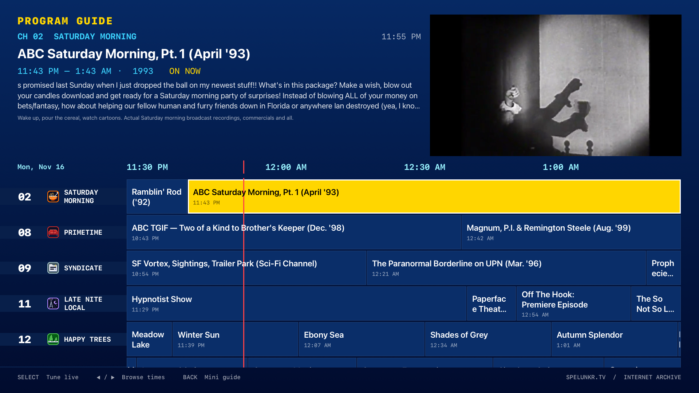

# Spelunkr for Apple TV — UNOFFICIAL

**This is an UNOFFICIAL third-party app. It is not made by, affiliated with, or endorsed by the creator of Spelunkr.tv. For the official service, visit [spelunkr.tv](https://spelunkr.tv).**

A native, independent tvOS client for [spelunkr.tv](https://spelunkr.tv). It tunes into the same synchronized broadcasts, plays Internet Archive tapes through AVPlayer, and puts the guide beside the picture.



## The viewing layout

With the mini guide open, the **video fills the TV's height and sits against the left edge**, preserving its original proportions. A 4:3 tape on a 1920 × 1080 display gets a 1440 × 1080 picture and a 480-pixel sidebar. If a tape is wider, the mini guide covers the right edge of the picture instead of shrinking it to make room.

Press **Right again** for a classic blue full-screen program guide: a two-hour schedule, channel numbers and pixel icons, program details, earlier/later pages, and the currently playing channel in the top-right corner. Version 0.1.3 enlarges that preview and removes the Watch TV, Earlier, Now, and Later buttons. A red line marks the current time above the cell backgrounds and behind the text; the playing program has a lighter blue background. Browsing does not retune. Select a program to tune that channel live. Left/Right navigate the schedule, including returning from a later time page. Back returns to the mini guide; Back again closes it and centers the video. There is no Full Screen button.

All viewing modes use the same AVPlayer and preserve playback while the layout changes. The original picture is never stretched. Up, Down, or Select while watching opens **native tvOS playback controls**, including **Rejoin Live**, **Last Channel**, and guide actions. Seeking and fast-forward cannot play beyond the current live position; rewinding remains available.

Both guides open on the channel currently playing. Up/Down in the current-time page selects the program airing now on the destination channel. Channel numbers, including three-digit numbers, stay on one line. Guide scrolling uses a quick slide animation; Reduce Motion disables the animation. Version 0.1.3 further reduces circular scrolling to four rows per slow turn, with softer acceleration and at least 160 ms between row movements. The guides show available tape synopses with smaller channel descriptions underneath. Summaries use cached metadata; stopping on an uncached program for a second can fetch its metadata from Internet Archive. Fast scrolling cancels that delay, and no extra description requests go to Spelunkr's server.

## How to install

Requires an Apple TV running **tvOS 17 or later**. There is no App Store or TestFlight release.

### Install the release IPA

1. Open [GitHub Releases](https://github.com/snugwarms/spelunkr.tv-tvOS/releases) and download `Spelunkr-tvOS-unsigned.ipa` from the release's **Assets** list.
2. Sign the IPA for your Apple TV using a tvOS-compatible signing service or your own Apple developer certificate and provisioning profile. The downloaded IPA is unsigned and cannot be installed directly.
3. Follow your signing service's Apple TV installation instructions, then launch **Spelunkr** from the Apple TV Home Screen.

For signing and sideloading, I personally recommend [Signulous](https://www.signulous.com/). Register or link your Apple TV with its **tvOS Code Signing** option, then upload the downloaded IPA to its signing dashboard. Signulous is a separate paid service.

### Build and install with Xcode

Requires a Mac with **Xcode 27.2** and tvOS platform support installed.

1. Clone this repository or download and extract its source, then open `Spelunkr.xcodeproj` in Xcode. No third-party packages or project generator are required.
2. Add your Apple Account in Xcode's settings. Select the **Spelunkr** target, then **Signing & Capabilities**, enable automatic signing, and choose your development team and a unique bundle identifier if needed.
3. Connect your Mac and Apple TV to the same network. On the Apple TV, open **Settings > Remotes and Devices > Remote App and Devices**.
4. In Xcode, open **Manage Devices** from the run destination menu. In Device Hub, choose **+ > Pair Nearby Device**, select Apple TV, and follow the pairing prompts. See [Apple's pairing guide](https://developer.apple.com/documentation/xcode/managing-your-simulated-and-physical-devices-in-device-hub) for details.
5. Select your Apple TV as the run destination and press **Run**. Xcode builds, signs, and installs the app.

An unsigned device package can also be generated with `./scripts/package.sh`; the result is `build/Spelunkr-tvOS-unsigned.ipa`. Sign it with an appropriate tvOS provisioning profile before installing it on a real Apple TV.

## Comments and reactions

The app reads the same public, moderated tape comments and reactions as the website. Comments appear in the **bottom left** when playback reaches their timestamp on the tape. They persist upstream and reappear on future broadcasts of that recording; they are not a transient chat tied to one airing. Rewinding re-arms later comments so they can appear again.

The website's seven **yellow SVG reaction icons** float upward over the video. Comments and reactions are fetched every **five minutes** for a limited tape-time window, then presented when the player's actual recording position crosses their saved timestamp. A new record received after its timestamp is skipped rather than shown late. Rewinding re-arms future timestamps. The mini guide's speech-bubble menu independently toggles the overlays; disabled overlays make no new endpoint requests. Account login, posting comments, and sending reactions are not implemented.

## Remote controls

| Control | Action |
| --- | --- |
| Right while watching | Open the mini guide |
| Right in the mini guide | Open the full program guide |
| Back in a guide | Full guide → mini guide → watching |
| Left in the mini guide | Close the mini guide |
| Up / Down in a guide | Browse channels without retuning; held arrows repeat at a controlled rate |
| Left / Right in the full guide | Browse programs and earlier/later schedule pages |
| Select on a channel | Tune the live broadcast |
| Up / Down / Select while watching | Open native player controls |
| Play / Pause | Pause or resume playback |
| Hold Select on a channel | Add or remove a favorite |
| Last Channel in native controls | Return to the previous channel |
| Rejoin Live in native controls | Resynchronize to the live broadcast |

Favorites and the last channel survive app restarts. Reopening or returning from the background rejoins the current broadcast and starts playing, even if playback was paused before leaving. Opening Quick Settings keeps video playing and does not retune when the menu closes. Programs, ads, and station breaks advance at their scheduled wall-clock boundaries; network retries cannot replace a more recently selected channel. Standard tvOS focus navigation handles directional touchpad swipes. Circular touch input is also mapped to channel-row navigation through GameController, while AVKit provides its native transport gestures. Circular gestures require physical Siri Remote validation; simulator checks cover button navigation.

The installed app version appears at the **bottom right of the mini guide**, beneath the credits. Playback errors explain whether the problem is access, a missing recording, a connection, stalled loading, or an unsupported format. Retryable errors give the retry delay; a smaller server/code line helps with troubleshooting.

Physical arrows in the full guide are tracked from press to release: one move on key-down, then repeats only after a 500 ms hold, every 220 ms. The app does not treat the operating system's key-repeat bursts as separate taps. Icons use the live lineup's pixel artwork and palette, below the number in the mini guide and beside it in the full guide.

## Captions and volume leveling

**Subtitles** uses a single control in the native playback controls. When the tape offers embedded or tvOS-generated subtitles, the native subtitle menu handles selection and the app hides its extra caption toggle. Otherwise, the app's **Subtitles: On / Off** control uses Apple's on-device SpeechAnalyzer on supported tvOS 26+ devices. Version 0.1.4 saves choices made in either control, including native subtitle language and generated/embedded preference, and restores On or Off after closing/reopening, background return, or a channel change. If the exact track is unavailable on another tape, the app prefers the same language before another available track.

Automatic caption processing starts after video is ready, can download Apple's speech model on first use, and transcribes the video audio directly without a microphone. Speech-model support varies by device. The simulator reports transcription unavailable; physical-device transcription still needs confirmation. [Apple's media-selection delegate](https://developer.apple.com/documentation/avkit/avplayerviewcontrollerdelegate/playerviewcontroller(_:didselect:in:)) supplies native menu choices so the app can remember them.

**Volume Leveling**, enabled by default, processes tapes, ads, and bumper music through the same audio path. A vendored EBU R128 / BS.1770 loudness meter targets **−23 LUFS**, with bounded gain, a fast reduction/slow recovery curve, silence protection, and true-peak-aware gain limiting plus a sample-peak failsafe. It does not intentionally delay audio or video; reactions and comments remain tied to the displayed tape position. The meter needs a brief settling period as a recording starts, so this is streaming normalization rather than an offline whole-program mastering pass. Very quiet recordings can remain below target because boost is capped. The native controls can turn leveling off, and the setting is remembered.

The shared audio tap sends original audio to speech recognition while applying leveling to playback. Turning captions off does not turn leveling off. The LUFS meter is [libebur128 1.2.6](https://github.com/jiixyj/libebur128/tree/v1.2.6), included in source under its MIT license; notices are bundled with the app.

The app requests two-channel output, disables spatialization on both the video and bumper player items, and reapplies the stereo preference when the output route changes. On tvOS 27, the audio-processing format also requests stereo downmixing. AirPods output still needs physical-device verification; an explicit user override in Control Center can take precedence over an app's spatialization preference.

## Development and checks

```sh
./scripts/build.sh
swift test -c release
# Include the remote / layout simulator check:
./scripts/test.sh 'platform=tvOS Simulator,name=Apple TV 4K (4th generation) (at 1080p)'
# Inspect real feeds and a tape's resolved media URL:
swift run spelunkr-probe --media computer-chronicles
# Diagnose only the requested channels:
swift run spelunkr-probe --media open-mic --media warp-zone
```

The Xcode project is checked in. After adding native app or UI-test files, regenerate it with `python3 scripts/generate-project.py` (Python standard library only). The core is a local Swift package; JavaScriptCore executes a pinned, bundled scheduler, with all networking handled by Swift. The app requires no companion computer or server.

The simulator checks run the **Release** configuration used for the IPA. Version 0.1.1 replaces tuple results in guide-loading task groups with concrete result records, fixing a reproduced optimized-build abort in `AsyncTask.completeFuture` during startup. The IPA is small because recordings stream from the Internet Archive and Apple's player frameworks are supplied by tvOS; no video recordings or speech models are bundled.

Version 0.1.5 supplies the website's required Origin and Referer on requests to Spelunkr's broadcast hosts, fixing reproduced HTTP 403 responses for the Open Mic and Warp Zone manifests. These headers are restricted to Spelunkr hosts, and no polling or probe requests are added. The diagnostic CLI can inspect several selected channels in one run without loading the entire guide. Archive playback checks in `PlaybackDiagnosticsTests` are opt-in with the `TEST_RUNNER_SPELUNKR_LIVE_PLAYBACK_TESTS=1` environment variable before `xcodebuild`, so ordinary test runs do not stream those recordings.

Version 0.1.6 follows up on the reported freeze after that feed fix. It tries Archive's primary storage address first, keeps distinct replicas as backups, retains slow loads while progress is arriving, starts available playback promptly, and catches up after a delayed live seek. A manual rewind remains under the viewer's control. When Archive provides an H.264 transcode for an incompatible source, the resolver selects the conversion of the same recording; it does not substitute another episode. The three reported tapes were checked as 640×480 H.264 level 3.0 plus stereo AAC-LC, within [Apple TV 4K third-generation format support](https://support.apple.com/en-us/111839), and did not require conversion.

The 0.1.6 validation passed **35 Release core tests and 16 Release simulator checks**. The player-model checks verify distinct-server recovery, a real 30-second live-range delay followed by advancing video frames near live, manual rewind, and clear terminal errors. Live tape checks use a temporary local byte relay because this development machine's native external connections fail even for a control recording. The relay and test media fixtures are excluded from the IPA; physical Apple TV playback remains a separate confirmation.

See [PROVENANCE.md](PROVENANCE.md) for source attribution, the scheduler pin, and validation details. This is a native viewing client: website account features, Discord login, submissions, and the site's non-viewing pages are not implemented.
